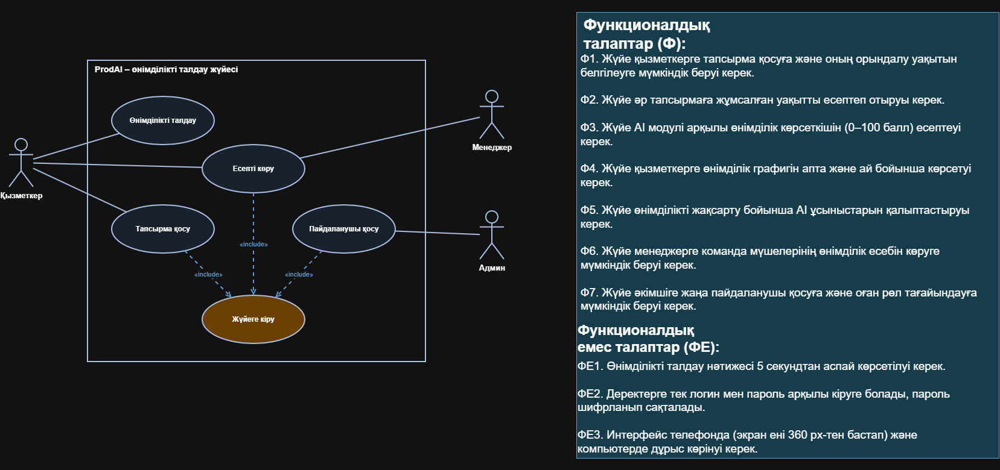
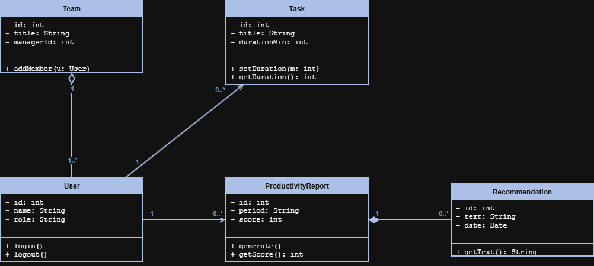
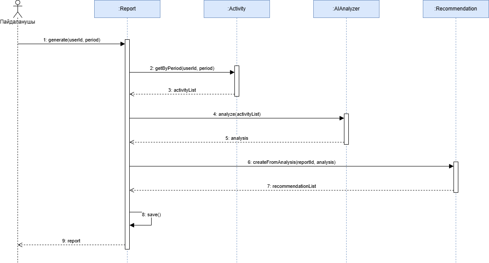

# ActivityMind

Автор: Муталипов Алихан, ВТК-24-1Б

## Мәселе

Компьютерде жұмыс істегенде көп адам уақытының қайда кетіп жатқанын нақты білмейді, сондықтан өнімділігін бағалап, жақсарта алмайды. ActivityMind — компьютердегі белсенділікті автоматты түрде бақылайтын (Desktop Agent), оны жасанды интеллект арқылы талдайтын және жеке ұсыныстар беретін гибридті жүйе (веб-платформа). Жүйе студенттерге, бағдарламашыларға, фрилансерлерге және офис қызметкерлеріне уақытын бақылауға көмектеседі.

## Акторлар

- Пайдаланушы
- Админ
- Desktop Agent (сыртқы жүйе)
- AI Analyzer (сыртқы жүйе)

## Талаптар

### Функционалдық

1. Жүйе пайдаланушының белсенді қолданбалары мен терезелерін автоматты түрде бақылауы керек.
2. Жүйе әр қолданбаны пайдалану ұзақтығын және бос тұрған (әрекетсіз) кезеңдерді есептеуі керек.
3. Жүйе қолданбаларды категорияларға (жұмыс, оқу, бағдарламалау, қарым-қатынас, ойын-сауық) бөлуі және пайдаланушыға категорияны өзгертуге мүмкіндік беруі керек.
4. Жүйе өнімді белсенділік пен ойын-сауық қатынасын, қолданбалар арасында ауысу жиілігін талдауы керек.
5. AI-модуль күн, апта және ай бойынша өнімділікті бағалап, есеп пен ұсыныстар қалыптастыруы керек.
6. Жүйе күндік, апталық және айлық статистика мен графиктерді көрсетуі керек.
7. Жүйе есепті PDF немесе Excel форматына экспорттауға мүмкіндік беруі керек.
8. Жүйе пайдаланушыға мақсат қоюға және жоспарланған уақытты нақты уақытпен салыстыруға мүмкіндік беруі керек.
9. Жүйе пайдаланушыға мониторингті тоқтатып, қайта жалғастыруға мүмкіндік беруі керек.
10. Әкімші пайдаланушыларды, қолданба категорияларын және жүйе параметрлерін басқара алуы керек.

### Функционалдық емес

1. Өнімділік: негізгі беттер қалыпты байланыста 3 секундтан артық жүктелмеуі керек.
2. Қауіпсіздік: құпиясөздер мен дербес деректер қорғалуы керек.
3. Сенімділік: Desktop Agent интернет болмаса да деректерді сақтап (SQLite), кейін серверге синхрондауы керек.
4. Ыңғайлылық: интерфейс техникалық білімі жоқ пайдаланушыға түсінікті болуы керек.
5. Масштабталу: архитектура пайдаланушылар санының өсуін қолдауы керек.
6. Үйлесімділік: веб-платформа заманауи браузерлерде, Desktop Agent Windows-та жұмыс істеуі керек.
7. Құпиялылық: жүйе пернетақта басуларын, құпиясөздерді, жеке хабарламалар мен құжат мазмұнын жазбауы керек; пайдаланушы мониторинг пен деректерін өзі басқара алуы керек.

## Диаграммалар

### 1. Use Case

### 2. Class

### 3. Activity: Өнімділік есебін құру және AI-ұсыныстарын алу

### 4. Sequence: Өнімділік есебін құру және AI-ұсыныстарын алу

