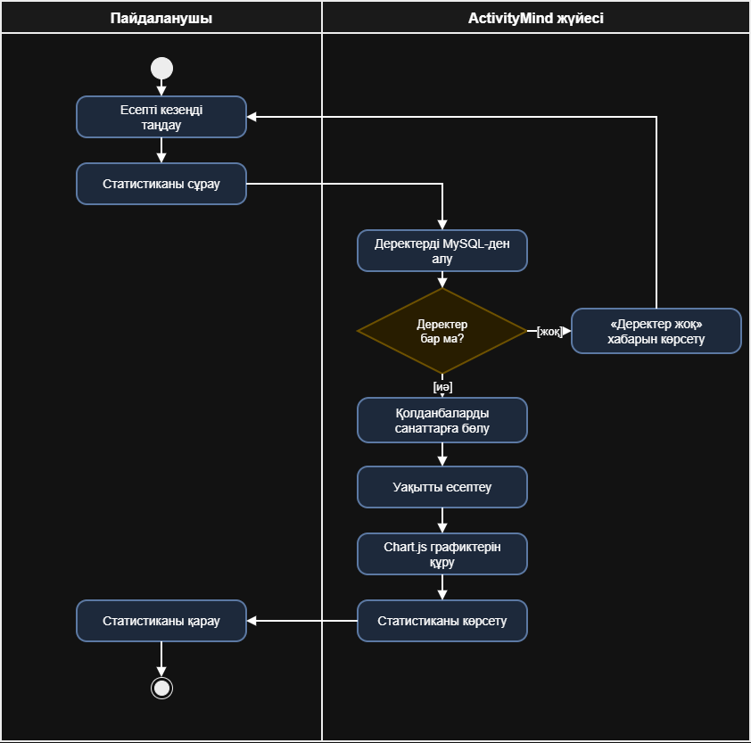

# ActivityMind — пайдаланушының жеке өнімділігін бақылау және талдау жүйесі

Автор: Мүтәліпов Әлихан, Втк-24-1б

## Мәселе

Көп адам компьютерде уақытының қайда кететінін білмейді, сондықтан өз өнімділігін объективті бағалай алмайды. ActivityMind Desktop Agent арқылы ашық қолданбалар мен олардың жұмыс уақытын автоматты түрде жинап, веб-қосымшада статистика, графиктер, есептер және ұсыныстар көрсетеді. Жүйе студенттерге, бағдарламашыларға, фрилансерлерге және жұмыс белсенділігін талдағысы келетін ұйымдарға арналған.

## Акторлар

- Пайдаланушы
- Desktop Agent (Python, фондық бағдарлама)
- Laravel сервері (API және MySQL дерекқоры)

## Талаптар

### Функционалдық

**Ф1.** Жүйе қызметкерге тапсырма қосуға және оның орындалу уақытын белгілеуге мүмкіндік беруі керек. 

**Ф2.** Жүйе әр тапсырмаға жұмсалған уақытты есептеп отыруы керек.

**Ф3.** Жүйе AI модулі арқылы өнімділік көрсеткішін (0–100 балл) есептеуі керек. 

**Ф4.** Жүйе қызметкерге өнімділік графигін апта және ай бойынша көрсетуі керек.

**Ф5.** Жүйе өнімділікті жақсарту бойынша AI ұсыныстарын қалыптастыруы керек. 

**Ф6.** Жүйе менеджерге команда мүшелерінің өнімділік есебін көруге мүмкіндік беруі керек. 

**Ф7.** Жүйе әкімшіге жаңа пайдаланушы қосуға және оған рөл тағайындауға мүмкіндік беруі керек.

### Функционалдық емес

**ФЕ1.** Өнімділікті талдау нәтижесі 5 секундтан аспай көрсетілуі керек. 

**ФЕ2.** Деректерге тек логин мен пароль арқылы кіруге болады, пароль шифрланып сақталады. 

**ФЕ3.** Интерфейс телефонда (экран ені 360 px-тен бастап) және компьютерде дұрыс көрінуі керек.

## Диаграммалар

### 1. Use Case

![Use_Case] (docs/diagrams/01-usecase.png)._x

### 2. Class

![Class] (docs/diagrams/02-class.png)._

### 3. Activity: Белсенділік статистикасын қарау

