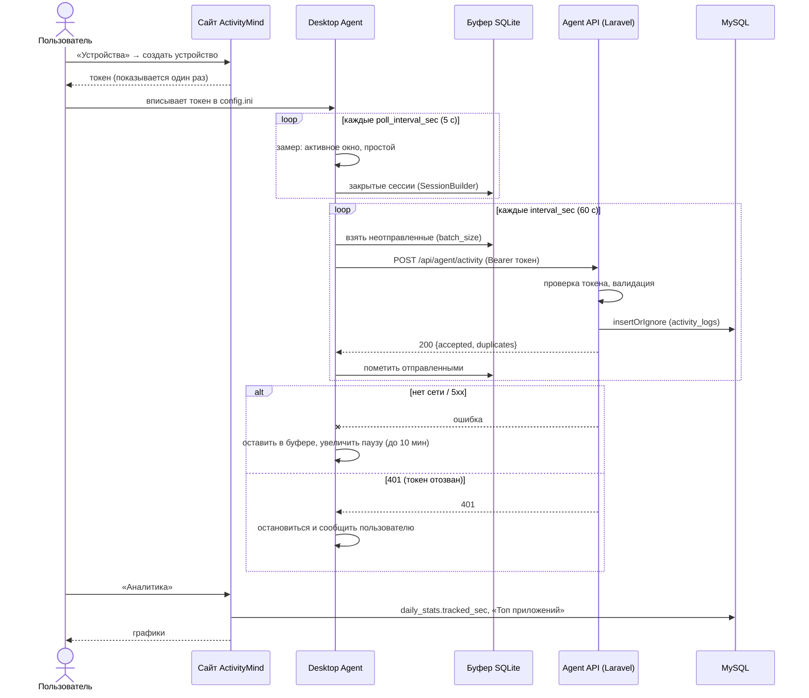
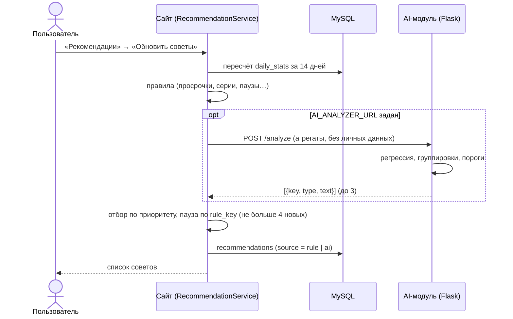

# Agent API

API для Desktop Agent. Префикс `/api`, формат JSON, аутентификация — токен устройства.

## Аутентификация
1. Пользователь создаёт устройство на странице **«Устройства»** — сайт показывает токен вида `amd_…` **один раз**.
2. Агент передаёт его в каждом запросе: `Authorization: Bearer amd_…`.
3. В БД хранится только SHA-256 от токена (`devices.token_hash`). Потерянный токен перевыпускается — старый сразу перестаёт работать.

Ответ без токена или с неверным токеном: `401 {"message": "Неверный или отсутствующий токен устройства."}`.
Лимит: 300 запросов в минуту.

## POST /api/agent/heartbeat
Проверка токена и связи. Обновляет `devices.last_sync_at`.

Ответ `200`:
```json
{ "ok": true, "device": { "id": 1, "name": "Ноутбук" }, "server_time": "2026-11-15T10:00:00+00:00" }
```

## POST /api/agent/activity
Приём пачки сессий активности (до 500 за запрос).

Запрос:
```json
{
  "items": [
    {
      "app_name": "Code",
      "window_title": "main.php - ActivityMind",
      "started_at": "2026-11-15T10:00:00Z",
      "duration_sec": 600,
      "is_idle": false
    }
  ]
}
```
| Поле | Правила |
|---|---|
| `items` | массив, 1–500 элементов |
| `app_name` | строка, до 255 символов |
| `window_title` | необязательно, до 1000 символов (сохраняется первые 255); агент отправляет только если включено `track_window_titles` |
| `started_at` | дата-время ISO 8601 (UTC), не позже чем через 5 минут от текущего |
| `duration_sec` | целое 1–86400 |
| `is_idle` | необязательно, boolean; сессии простоя не получают категорию и не входят в `tracked_sec` |

Ответ `200`: `{ "accepted": 1, "duplicates": 0 }`.
Ошибка валидации: `422` со стандартным телом Laravel (`message`, `errors`).

**Идемпотентность.** Запись определяется тройкой (`device_id`, `started_at`, `app_name`) — уникальный индекс. Повторная отправка той же пачки (например, после обрыва связи) не создаёт дублей: такие записи попадают в `duplicates`.

**Категории.** Сервер сам определяет системную категорию (`AppCategorizer`): сначала по заголовку окна, затем по имени приложения; браузеры без подсказки по заголовку попадают в «Прочее», неизвестные приложения остаются без категории.

## Диаграмма последовательности (отправка активности)


---

# AI Analyzer API
Сервис в `ai-module/`, вызывается **сайтом** (не агентом). Подробности и пороги — в `ai-module/README.md`.

## POST /analyze
Заголовок `Authorization: Bearer …` — только если задан `AI_ANALYZER_TOKEN`.

Запрос:
```json
{
  "user_id": 1,
  "timezone": "Asia/Almaty",
  "days": { "2026-11-02": { "focus_sec": 16560, "tracked_sec": 0, "tasks_done": 2, "habits_done": 4, "habits_total": 4, "score": 92 } },
  "hours": [0, 0, 0, 0, 0, 0, 0, 0, 0, 1.2, 2.4, 2.1, 0, 0, 1.6, 1.9, 1.2, 0, 0, 0, 0.8, 0, 0, 0]
}
```
Последний день в `days` считается сегодняшним и не учитывается (`include_last_day: true` — учитывать).

Ответ `200`: `[{ "key": "trend_down", "type": "focus", "text": "…" }]` — от 0 до 3 элементов. `400 {"message": …}` — неверный формат; `401` — неверный токен.

## Диаграмма последовательности (генерация AI-советов)


---
