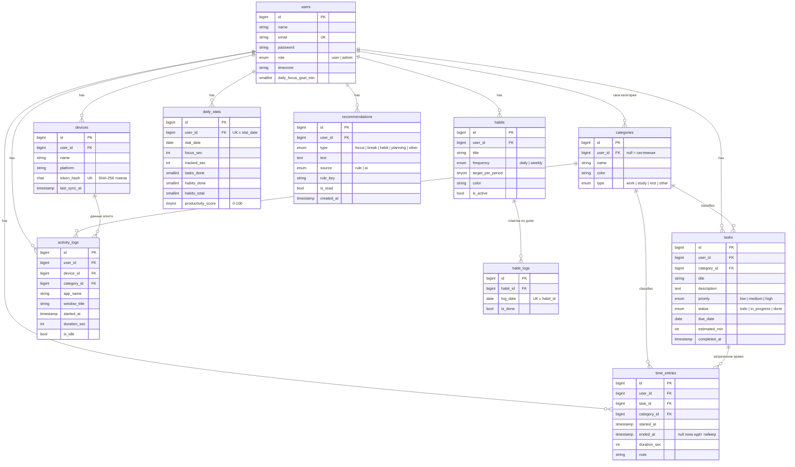

# ActivityMind — база данных

СУБД: MySQL (XAMPP). Время хранится в UTC, даты дней — в часовом поясе пользователя (`users.timezone`).

## ER-диаграмма

## Правила целостности
- Все пользовательские данные удаляются каскадом при удалении пользователя (`ON DELETE CASCADE` по `user_id`).
- Удаление категории или задачи не удаляет записи времени: `category_id` / `task_id` становятся `NULL` (`ON DELETE SET NULL`).
- `habit_logs`: уникальная пара (`habit_id`, `log_date`) — одна отметка на привычку в день.
- `daily_stats`: уникальная пара (`user_id`, `stat_date`) — пересчёт идемпотентен (`upsert`).
- `devices.token_hash`: уникален; открытый токен нигде не хранится. `activity_logs`: уникальная тройка (`device_id`, `started_at`, `app_name`) — повторная отправка пачки не создаёт дублей.
- Индексы: `tasks (user_id, status)`, `tasks (user_id, due_date)`, `time_entries (user_id, started_at)`, `activity_logs (user_id, started_at)`, `recommendations (user_id, rule_key, created_at)`.

## Назначение таблиц
| Таблица | Кто пишет | Кто читает |
|---|---|---|
| `tasks` | пользователь (страница «Задачи») | дашборд, задачи, рекомендации, статистика |
| `time_entries` | таймер / ручная запись | дашборд, аналитика, `daily_stats` |
| `habits`, `habit_logs` | пользователь (клик по кружку дня) | привычки, дашборд, статистика, рекомендации |
| `daily_stats` | `StatsService::sync()` (страница аналитики, команда `recalc-stats`, рекомендации) | аналитика, AI-модуль |
| `recommendations` | `RecommendationService` (правила), AI-модуль | страница рекомендаций, дашборд |
| `devices`, `activity_logs` | Desktop Agent через Agent API | аналитика («Топ приложений»), `daily_stats.tracked_sec` |
